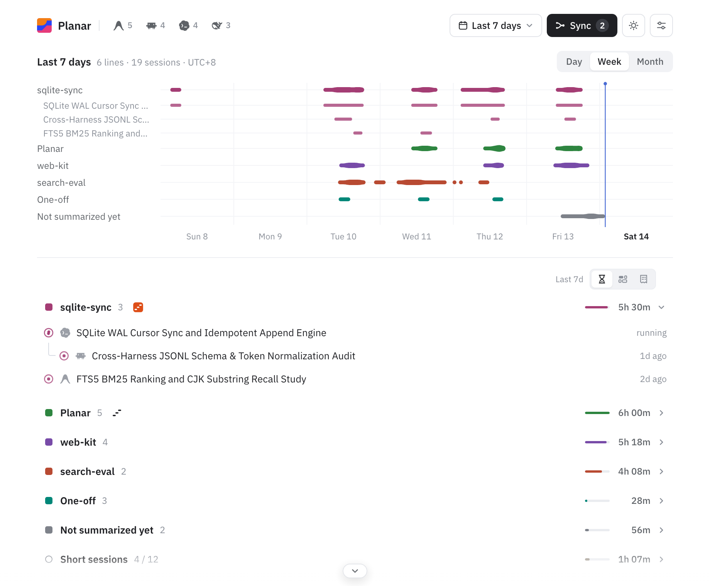
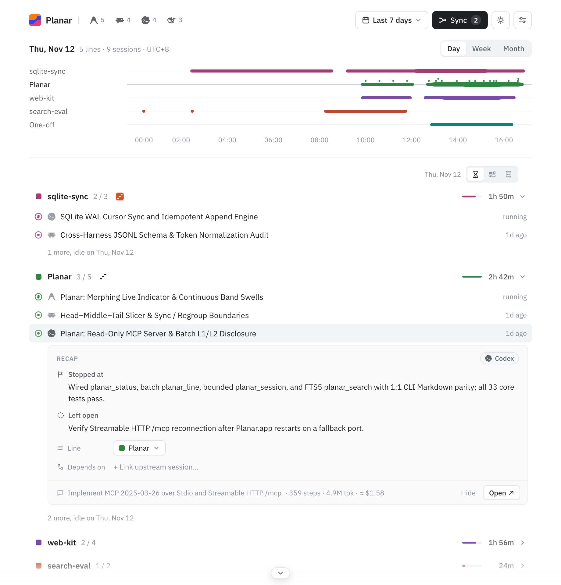

<p align="center">
  
</p>

<h1 align="center">Planar</h1>

<p align="center">
  <strong>A shared map of the work you do with agents.</strong><br />
  <a href="./README.md">English</a> · <a href="./README.zh-CN.md">简体中文</a>
</p>

<p align="center">
  Planar quietly reads the sessions your coding agents already leave on disk — Claude Code, Codex, Antigravity, and DeepSeek Harness (<code>dsh</code>) — and lays them out as lines of work over time: where each one stopped, where the hours went, and what to hand your next agent.
</p>

<p align="center">
  <code>local-first</code> · <code>read-only</code> · <code>macOS app + CLI + MCP</code> · <code>MIT</code>
</p>

> [!NOTE]
> **Experimental (`0.1.0-alpha.0`)** — Planar is under active experimental development and is simultaneously built as a reference **Agent-Native Open-Source Repository**. Schemas, CLI flags, and agent workflows may evolve rapidly while we stabilize `v0.1.0`.

<p align="center">
  
</p>

| **Where things stand** | **Where the time went** | **Where your agent picks up** |
| :--- | :--- | :--- |
| Every line of work, its last stop (`Stopped at`), what's `Left open`, and cross-session dependencies. | Honest `agent time` vs. `wall clock` (12m idle cap), 20-week heatmap, and offline `Tokens` & `Cost` lenses. | Progressive context (`L0 → L1 → L2` + FTS5) in `< 3k` tokens via CLI, read-only MCP, or Agent Skill. |

```bash
planar status --days 7               # L0: all active lines of work, at a glance
planar line <slug>                   # L1: where a line stopped, what's open, dependencies
planar session <id> --focus handoff  # L2: tool-stripped handoff slice + exact resume command
planar mcp config                    # let any personal agent read the map over MCP
```

## Why a Map?

Every agent session leaves a trajectory on disk, buried under megabytes of tool output. Grouping by folder breaks as soon as ten parallel sessions share one workspace; generic memory stores hold disconnected facts without direction or time.

Planar reads your local transcripts **strictly read-only** (zero wrappers, zero manual ticket-filing) and distills them into one local plane — **`Lines × Time`** — built for both humans and personal agents:

- **Semantic Lines, Not Folder Buckets**: Sorts concurrent sessions into persistent lanes (`Pinned` + `Found by Planar` + `One-off`). Incremental `Sync` never renames or overwrites your pinned lines; explicit `Regroup` reorganizes unpinned ones only when you ask.
- **Head–Middle–Tail Slicing**: Skips `< 3`-turn throwaway chats; strips tool payloads unconditionally while preserving opening turns, **mid-session user prompts** (capturing direction changes), and closing turns at ~5% token cost.
- **One Local Core, Three Surfaces**: ~15 MB macOS Tauri v2 desktop & menu-bar app (`Planar.app`), zero-build vanilla Web UI (`./ui`, responsive down to `320px` IDE sidebars), and sub-5ms native CLI + read-only MCP (`2025-03-26`) + [`skills/planar/SKILL.md`](./skills/planar/SKILL.md).

<p align="center">
  
</p>

## Quick Start

**Prerequisites:** Rust stable (Edition `2024`) and Node.js `>= 20`.

```bash
# 1. Install dev dependencies & activate repo Git hooks
npm install
npm run hooks:install

# 2. Preview the zero-backend UI immediately (?mock=1, add &sidebar=350 for narrow mode)
npm run preview

# 3. Install the native CLI and run the daily-driver loop
cargo install --path crates/planar-cli
planar sync                          # Incrementally scan local harnesses & summarize pending/grown sessions
planar status --days 7               # L0 map overview (~300-600 tokens)
planar line <slug>                   # L1 line brief, stopped-at, left-open & dependencies
planar session <id> --focus handoff  # L2 handoff slice + resume command
planar open <id>                     # Copy resume command or open workspace

# 4. Build & launch the macOS desktop + menu-bar app, or print MCP snippets
npm run app:install && npm run app:open
planar mcp config
```

## Agent-Native Repository Layout

Planar is structured so any coding agent (**Claude Code**, **Codex**, **Antigravity**, **DSH**, **Cursor**) or human contributor can orient in seconds and self-verify mechanically:

| Layer | Path | Purpose |
| :--- | :--- | :--- |
| **Agent Router** | [`AGENTS.md`](./AGENTS.md) (`CLAUDE.md` symlink) | Compact L0 entry point: invariants, directory boundaries, verification commands |
| **Durable Contexts** | [`contexts/CONTEXT_MAP.md`](./contexts/CONTEXT_MAP.md) | Single home for product design, architecture, release/versioning, UI contract, and hooks |
| **Repo Contributor Skills** | [`.agents/skills/planar-dev/SKILL.md`](./.agents/skills/planar-dev/SKILL.md) | Contributor SOPs (`planar-dev` + version-locked `rust-best-practices`, `rust-async-patterns`, `rust-review`; symlinked at `.claude/skills`) |
| **Risk-Tiered Review** | [`REVIEW.md`](./REVIEW.md) & [`CONTRIBUTING.md`](./CONTRIBUTING.md) | `T0`–`T3` review tiers by blast radius, invariant checklists, and contribution guide |
| **Mechanical Guardrails** | [`.githooks/`](./.githooks) & [`scripts/hooks/`](./scripts/hooks) | Universal Git hooks (`pre-commit`, `commit-msg`, `pre-push`), Claude/Codex `PreToolUse` PR & Issue guards, and `npm run verify` |
| **Shipped Agent Skill** | [`skills/planar/SKILL.md`](./skills/planar/SKILL.md) | End-user progressive-disclosure protocol (`L0 → batch L1 → bounded L2`) |

## Verification & License

```bash
npm run verify   # Biome + node --check + rustfmt + clippy -D warnings + hygiene + cargo test + hook tests
```

Released under the [MIT License](./LICENSE).
