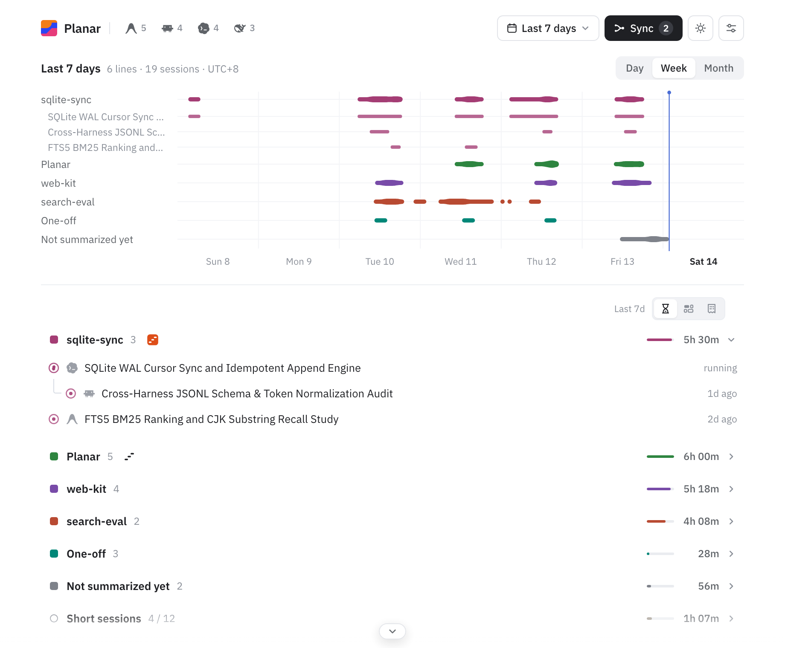
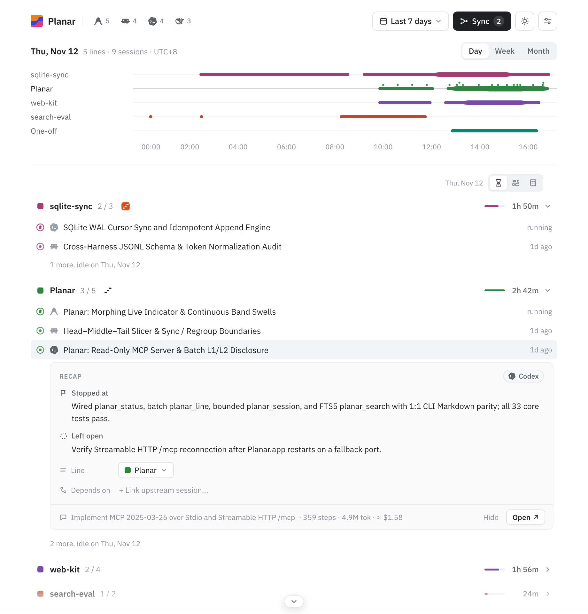

<p align="center">
  
</p>

<h1 align="center">Planar</h1>

<p align="center">
  <strong>一张你和 Agent 都读得懂的工作地图。</strong><br />
  <a href="./README.md">English</a> · <a href="./README.zh-CN.md">简体中文</a>
</p>

<p align="center">
  Planar 静默只读 Claude Code、Codex、Antigravity 与 DeepSeek Harness（<code>dsh</code>）留在本地的会话，把它们铺成随时间延展的工作线：每条线停在哪，时间真正花在哪，下一步该交给哪个 Agent。
</p>

<p align="center">
  <code>本地优先</code> · <code>纯只读零侵入</code> · <code>macOS 应用 + CLI + MCP</code> · <code>MIT</code>
</p>

> [!NOTE]
> **实验阶段（`0.1.0-alpha.0`）** — Planar 目前处于 **Experimental** 快速迭代期，同时作为一个 **Agent-Native 开源仓库标杆范例** 演进。在 `v0.1.0` 稳定前，数据结构、CLI 参数与 Agent 工作流可能持续调整。

<p align="center">
  
</p>

| **工作停在哪（Plan）** | **时间花在哪（Reflect）** | **Agent 从哪接手（Context）** |
| :--- | :--- | :--- |
| 每条工作线的最新停点（`Stopped at`）、遗留事项（`Left open`）与跨会话上下游依赖。 | 截断区间并集区分真实 `agent time` 与 `wall clock`，20 周热力图与独立 `Tokens` / `Cost` 透镜。 | 通过 CLI、只读 MCP 或 Skill 以 `< 3k` tokens 渐进式披露（`L0 → L1 → L2` + FTS5）供个人 Agent 直接读取。 |

```bash
planar status --days 7               # L0：一眼看清所有活跃工作线
planar line <slug>                   # L1：单条线的停点、遗留项与依赖关系
planar session <id> --focus handoff  # L2：剥离工具噪音的交接切片与精确恢复命令
planar mcp config                    # 让任何个人 Agent 通过 MCP 读取这张地图
```

## 为什么是一张地图？

每一次 Agent 会话都会在本地留下轨迹，但它们通常埋在数 MB 的工具输出里。多个并行会话共享同一个工作目录时，按文件夹归类立刻失效；而零散的记忆库只存事实碎片，给不了时间脉络与方向感。

Planar **严格以只读方式**解析本地轨迹（不套壳终端、不要求手工建单），把它们沉淀到一张本地的 **`Lines × Time` 平面**，同时服务于人与个人 Agent：

- **按语义工作线归拢**：自动收敛为持久的工作线（`Pinned` 固定线 + `Found by Planar` 发现线 + `One-off`）。增量 `Sync` 永不篡改你固定的工作线，只有显式执行 `Regroup` 才重排未固定线。
- **Head–Middle–Tail 三段式切片**：自动跳过 `< 3` 轮的短对话；无条件剥离工具输出，保留完整开头/结尾以及**中间段的用户提问**（留住中途改方向的原因），以约 5% 的 token 成本产出高信噪比上下文。
- **一套本地内核，三种形态**：约 15 MB 的 macOS Tauri v2 桌面端与菜单栏应用（`Planar.app`）、零构建原生 Web UI（`./ui`，自适应 `320px` IDE 侧栏），以及亚 5ms 原生 CLI + 只读 MCP（`2025-03-26`）+ [`skills/planar/SKILL.md`](./skills/planar/SKILL.md)。

<p align="center">
  
</p>

## 快速开始

**环境依赖**：Rust Stable（Edition `2024`）与 Node.js `>= 20`。

```bash
# 1. 安装开发依赖并启用仓库内置 Git Hooks
npm install
npm run hooks:install

# 2. 无需后端立即预览前端（?mock=1，附加 &sidebar=350 可预览窄侧栏模式）
npm run preview

# 3. 安装原生 CLI，体验「晚间归档 → 次日 30 秒恢复上下文」闭环
cargo install --path crates/planar-cli
planar sync                          # 增量扫描本地 harness 并摘要新增/增长的会话
planar status --days 7               # L0 全局工作线快照（约 300-600 tokens）
planar line <slug>                   # L1 工作线摘要、停点、遗留项与依赖
planar session <id> --focus handoff  # L2 去噪交接切片与精确恢复命令
planar open <id>                     # 复制恢复命令或直接唤起工作区

# 4. 构建并启动 macOS 桌面端 / 菜单栏应用，或输出 MCP 配置片段
npm run app:install && npm run app:open
planar mcp config
```

## Agent-Native 仓库结构

Planar 不仅服务于 Coding Agents，仓库本身也采用 **Agent-Native** 工程结构，让 Claude Code、Codex、Antigravity、DSH、Cursor 与人类贡献者都能通过渐进式披露秒懂上下文并用机械化门禁自验证：

| 层级 | 路径 | 职责 |
| :--- | :--- | :--- |
| **统一入口路由** | [`AGENTS.md`](./AGENTS.md)（`CLAUDE.md` 软链指向） | 精简 L0 入口：核心不变量、目录契约与本地验证命令 |
| **持久化上下文** | [`contexts/CONTEXT_MAP.md`](./contexts/CONTEXT_MAP.md) | 唯一上下文根目录：产品设计、系统架构、版本与发布规范、前端契约与 Hooks 架构 |
| **仓库开发 Skills** | [`.agents/skills/planar-dev/SKILL.md`](./.agents/skills/planar-dev/SKILL.md) | 贡献者 SOP（`planar-dev` + 版本锁定的 `rust-best-practices`、`rust-async-patterns`、`rust-review`，通过 `.claude/skills` 软链共享） |
| **分级审查协议** | [`REVIEW.md`](./REVIEW.md) 与 [`CONTRIBUTING.md`](./CONTRIBUTING.md) | 按变更影响半径定义 `T0`–`T3` 四档 Review 模式、不变量核对表与贡献指南 |
| **双层机械化门禁** | [`.githooks/`](./.githooks) 与 [`scripts/hooks/`](./scripts/hooks) | 通用 Git Hooks（`pre-commit` / `commit-msg` / `pre-push`）、Claude/Codex `PreToolUse` PR & Issue 守卫，以及一键 `npm run verify` |
| **产品内置 Skill** | [`skills/planar/SKILL.md`](./skills/planar/SKILL.md) | 随 Planar 发布的渐进式披露协议（`L0 → 批量 L1 → 有界 L2`） |

## 本地验证与开源协议

```bash
npm run verify   # Biome + node --check + rustfmt + clippy -D warnings + 隐私/链接体检 + cargo test + Hook 单测
```

本项目基于 [MIT License](./LICENSE) 开源。
