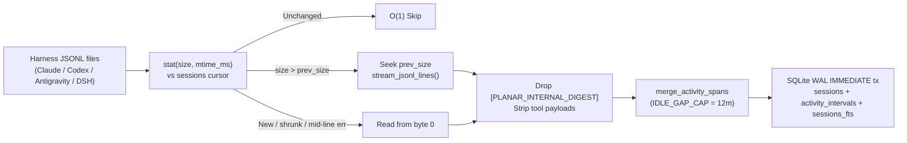

# Planar — Technical Architecture & Module Contracts

> Implementation map for `crates/planar-core`, `crates/planar-cli`, `src-tauri`, and `./ui`. For product motivation, slicing principles, and visual math, see [design.md](design.md).

---

## 1. Crate & Module Map

```text
planar/
├── crates/planar-core/src/     # Shared Rust engine (unsafe_code = "forbid", unwrap_used = "deny")
│   ├── lib.rs                  # Public crate exports
│   ├── model.rs                # Wire DTOs, AppSettings, OKLab palettes, sentinels
│   ├── error.rs                # PlanarError (thiserror) & Result<T>
│   ├── env.rs                  # Harness log roots, login-shell PATH hydration, CLI binary & resume-cmd helpers
│   ├── burst.rs                # Clamped burst union (IDLE_GAP_CAP_MS = 12m, MIN_BURST_MS = 60s) & day projection
│   ├── pricing.rs              # Offline model list-price table & compact token/cost formatting
│   ├── ingest/
│   │   ├── mod.rs              # Byte-cursor incremental JSONL streamer, ScanDecision, delegation-envelope stripper
│   │   ├── claude.rs           # ~/.claude/projects/**/*.jsonl (streaming usage dedup + subagents/)
│   │   ├── codex.rs            # ~/.codex/{sessions,archived_sessions}/**/*.jsonl (cumulative token_count + item spans)
│   │   ├── antigravity.rs      # ~/.gemini/antigravity/brain/*/.system_generated/logs/transcript.jsonl + subagent links
│   │   └── dsh.rs              # ~/.dsh/sessions/**/*.jsonl (DeepSeek Harness)
│   ├── db.rs                   # SQLite WAL + FTS5 Store, migrations, PlaneResponse, L0/L1/L2/Search queries, CRUD
│   ├── processor.rs            # Head-Middle-Tail slicer, slice_config_hash, Sync/Regroup prompts, CLI & API adapters
│   ├── render.rs               # Token-frugal Markdown formatters shared 1:1 by CLI and MCP
│   ├── mcp.rs                  # Read-only MCP 2025-03-26 JSON-RPC engine (Stdio + Streamable HTTP)
│   └── server.rs               # Axum router (/api/*, /mcp, disk/embedded ./ui) & session open dispatcher
├── crates/planar-cli/src/
│   └── main.rs                 # Native `planar` CLI binary (clap + tokio)
├── src-tauri/src/
│   ├── main.rs                 # Desktop entrypoint
│   └── lib.rs                  # Thin Tauri v2 window + macOS Menu-Bar tray hosting embedded Axum server
├── ui/                         # Zero-dependency vanilla HTML/CSS/ESM frontend (see contexts/engineering/ui-zero-fork.md)
│   ├── index.html              # Single-page shell + palette metadata
│   ├── styles.css              # Light/Dark tokens, @container narrow sidebar breakpoints, animations
│   └── app.js                  # State store, SVG bandProfile/bandPath renderer, RECAP card, DnD deps, Settings
├── skills/planar/SKILL.md      # Shipped user-facing planning skill (L0 -> L1 -> L2)
└── scripts/                    # Zero-dependency preview, hygiene checker, and agent hook guards
```

---

## 2. Data Flows

### 2.1 Incremental Read-Only Scan (`scan_all_harnesses`)



- **Associativity invariant**: `activity_intervals` stores unpadded `[start_ms, end_ms]` spans; `MIN_BURST_MS` (`60s`) is applied only at projection/summation time, guaranteeing that incremental appends yield identical intervals to full rescans.
- **Subagent rollup**: Child transcripts (`is_subagent = 1`, `parent_session_id = ...`) are excluded from top-level session lists while their token/cost totals roll up into their parent session.

### 2.2 Head–Middle–Tail Slicing & `Sync` vs `Regroup` (`processor.rs`)

1. `load_sync_candidates_in_scope` selects non-subagent, non-hidden sessions meeting `user_input_count >= fewest_user_inputs` where any of the following holds:
   - `line_id IS NULL` (unassigned), OR
   - `session_digests` row is missing, OR
   - `slice_config_hash` changed (slicer settings updated), OR
   - `step_count >= last_step_index + 2` (session grew by at least one new user/agent exchange).
   - Sessions with an existing digest whose `source_path` no longer exists on disk are **permanently locked**.
2. `slice_trajectory_file` streams the source JSONL read-only, skips tool payloads and `[PLANAR_INTERNAL_DIGEST]` echoes, and extracts `head`, `middle_users`, and `tail`.
3. Candidates are chunked by `sync_batch_limit` (default `4`, capped at `72,000` chars per prompt) and dispatched to either:
   - **Local CLI mode** (`agy`, `codex`, `dsh`, or `claude` in stateless/read-only print mode with `AUTO_CLI_ORDER = ["antigravity", "codex", "dsh", "claude"]`), or
   - **Direct API mode** (`gemini`, `anthropic`, `openai`, `deepseek`, `openrouter`, `xai`, `groq`, `mistral`, `siliconflow`, `moonshot`, `ollama`, or `openai-compatible`).
4. `apply_session_digest` updates `session_digests` + `sessions_fts`, and assigns `line_id` **only when** `line_id IS NULL` or the current Line is unpinned (`pinned = 0`).
5. `regroup_discovered_lines` clusters only sessions inside unpinned non-system Lines (`pinned = 0 AND is_system_bucket = 0`), passing pinned Lines + `Scope:` descriptions as exemplars, and prunes newly empty unpinned Lines.

---

## 3. SQLite Storage Schema (`~/.planar/planar.db`)

Every `rusqlite` connection executes:

```sql
PRAGMA journal_mode = WAL;
PRAGMA busy_timeout = 5000;
PRAGMA synchronous = NORMAL;
PRAGMA foreign_keys = ON;
```

| Table | Purpose |
| :--- | :--- |
| `lines` | Semantic Work Lines (`id`, `name`, `description`, `color`, `pinned`, `is_system_bucket`, `priority`, `status`, `sort_order`). Seeds system bucket `one-off` (`One-off`). |
| `sessions` | Ingested sessions with file cursors (`source_path`, `source_size`, `source_mtime_ms`), `cwd`, step/prompt counts, `archived`, `hidden`, `is_subagent`, `parent_session_id`, `has_open_turn`, `line_id`, `model`, and `(input, cache_read, cache_write, output, total)_tokens`. |
| `activity_intervals` | Unpadded clamped burst spans `(session_id, start_ms, end_ms)` (`ON DELETE CASCADE`). |
| `session_digests` | Structured recaps `(session_id, last_step_index, slice_config_hash, title, stopped_at, left_open, hidden)`. |
| `session_dependencies` | Directed upstream links `(from_session_id, to_session_id, kind, source)` (single-parent enforced by `upsert_dependency`). |
| `known_subagents` | Persistent `child_session_id -> parent_session_id` links discovered asynchronously. |
| `app_settings` | Key-value JSON settings (`app_settings`) plus idempotent migration flags (`schema_*_v1`). |
| `sessions_fts` | `FTS5` virtual table (`unicode61`) indexing `(title, stopped_at, left_open, first_user_prompt)` for `bm25` search with automatic CJK/punctuation substring fallback. |

---

## 4. HTTP API & UI Surface (`crates/planar-core/src/server.rs`)

Default loopback address: `http://127.0.0.1:4310` (`Planar.app` falls back to an ephemeral port if `4310` is occupied).

| Method & Route | Description |
| :--- | :--- |
| `GET /` → `GET /ui/` | Zero-fork frontend (disk `./ui` in dev, `include_str!` embedded in `Planar.app` / installed `planar` binary) |
| `GET /api/health` | Loopback readiness check (`{"ok": true}`) |
| `GET /api/plane?days=7&date=YYYY-MM-DD&rescan=0\|1` | Complete `PlaneResponse` (throttled `3s` auto-scan unless `rescan=1`), 20-week contributions, harness statuses |
| `POST /api/scan` | Force immediate incremental scan and return refreshed `PlaneResponse` |
| `POST /api/sync` | Synchronous scoped `Sync` batch (`days`, `date`, `harness`, `force`, `limit`) |
| `POST /api/sync/stream` | Streaming NDJSON `Sync` (`start`, `batchStart`, `heartbeat`, `batchDone`, `complete`) used by `./ui` and `planar sync` |
| `POST /api/regroup` | Re-cluster sessions inside unpinned Lines |
| `POST /api/processor/test` | Verify CLI or API processor connectivity and measure latency |
| `PUT /api/settings` | Validate and persist `AppSettings` |
| `POST /api/lines` | Create pinned Line (`name`, optional `description`) |
| `PATCH /api/lines/{id}` | Update `name`, `description`, `color` (`#RRGGBB`), `priority` (`0..=4`), `status`, `pinned` |
| `POST /api/lines/{id}/merge` | Merge source Line into `targetLineId` (moves sessions, pins target, appends scope hint) |
| `PATCH /api/sessions/{id}` | Reassign `lineId` (set or clear) and/or toggle `hidden` |
| `POST /api/sessions/{id}/open` | Copy harness resume command or open workspace (`Antigravity.app` / Finder fallback) |
| `PUT /api/dependencies` | Upsert `fromSessionId -> toSessionId` dependency |
| `DELETE /api/dependencies/{from_id}` | Remove outgoing dependency for `from_id` |
| `POST /mcp` (also `/api/mcp`) | Streamable HTTP MCP `2025-03-26` JSON-RPC endpoint (`202 Accepted` on notifications) |

---

## 5. CLI & Read-Only MCP Parity

Both `planar` CLI (`crates/planar-cli/src/main.rs`) and MCP (`crates/planar-core/src/mcp.rs`) render identical token-compact Markdown via `crates/planar-core/src/render.rs`:

| Capability | CLI Command | MCP Tool / Resource / Prompt | Read-Only? |
| :--- | :--- | :--- | :--- |
| **L0 Plane Snapshot** | `planar status [--days 7] [--cwd <path>] [--json] [--no-scan]` | `planar_status` / `planar://status` | Yes |
| **L1 Batch Line Drill-Down** | `planar line <line>... [--limit 8] [--json] [--no-scan]` | `planar_line` (`1..=8` lines) / `planar://line/{slug}` | Yes |
| **L2 Bounded Session Slice** | `planar session <id>... [--focus full\|handoff] [--json] [--no-scan]` | `planar_session` (`1..=3` sessions) | Yes |
| **FTS5 Recall** | `planar search <query> [--line <slug>] [--days <n>] [--limit 10] [--json]` | `planar_search` | Yes |
| **Guided Planning Rubric** | *(via Skill)* | `prompts/get` → `planar-plan` | Yes |
| **Jump Back to Session** | `planar open <id> [--print] [--json] [--no-scan]` | *(Resume command embedded in L2 output)* | Yes |
| **Log Scan** | `planar scan [--json]` | *(Auto-throttled `3s` on MCP calls)* | Local DB |
| **End-of-Day Summarization** | `planar sync [--days 7] [--date YYYY-MM-DD] [--harness <id>] [--limit <n>] [--force] [--no-scan] [--json]` | *Excluded from MCP v1 by design* | Writes digests |
| **Unpinned Re-Clustering** | `planar regroup [--json]` | *Excluded from MCP v1 by design* | Writes unpinned Lines |
| **MCP Stdio / Config** | `planar mcp` / `planar mcp config` | Stdio JSON-RPC `2025-03-26` | Yes |
| **Local Daemon + UI** | `planar serve [--host 127.0.0.1] [--port 4310] [--ui-dir <path>]` | Hosts `POST /mcp` alongside `./ui` | Local daemon |

---

## 6. Runtime Platform Invariants

1. **Tauri HTML5 DnD**: Keep `"dragDropEnabled": false` in `src-tauri/tauri.conf.json` so macOS `WKWebView` preserves HTML5 `draggable="true"` session dependency drag-and-drop.
2. **Single Login-Shell `$PATH` Hydration**: Call `planar_core::env::hydrate_macos_path()` **once** per GUI/daemon process and pass it into `AppState::with_hydrated_path(...)`.
3. **Zero `stdout` Pollution in Stdio MCP**: `planar mcp` reserves `stdout` strictly for single-line JSON-RPC frames; any diagnostic warning must go to `stderr`.
